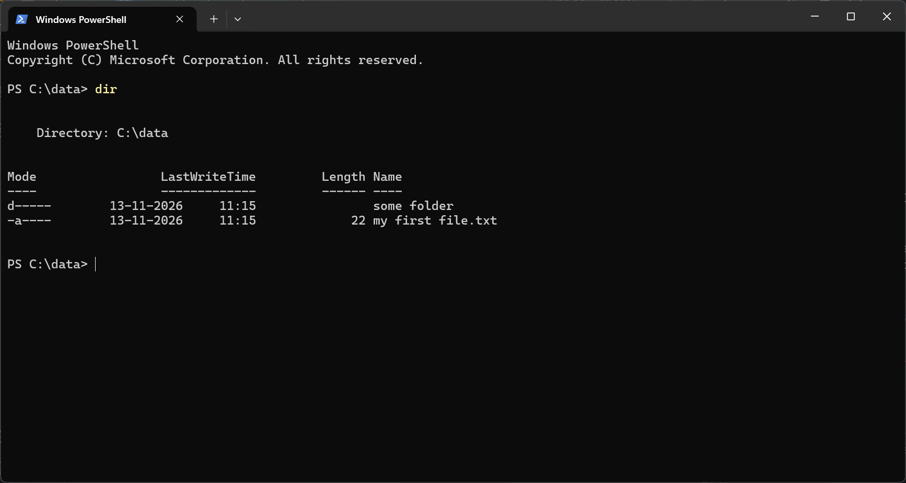

# First command

With the commandline open, one can give commands to the computer. Let's try that now. Type the following command and press enter:

    
COMMAND
 dir

Did you see what "dir" did? It listed the content of the directory. So what is happening?
When one is in the commandline (also called terminal) its always in the context of a "current folder". This is what is before the prompt, here its "C:\data". "dir" is then a program ran in the context of the current folder, this is how it knows which folder to display. 

