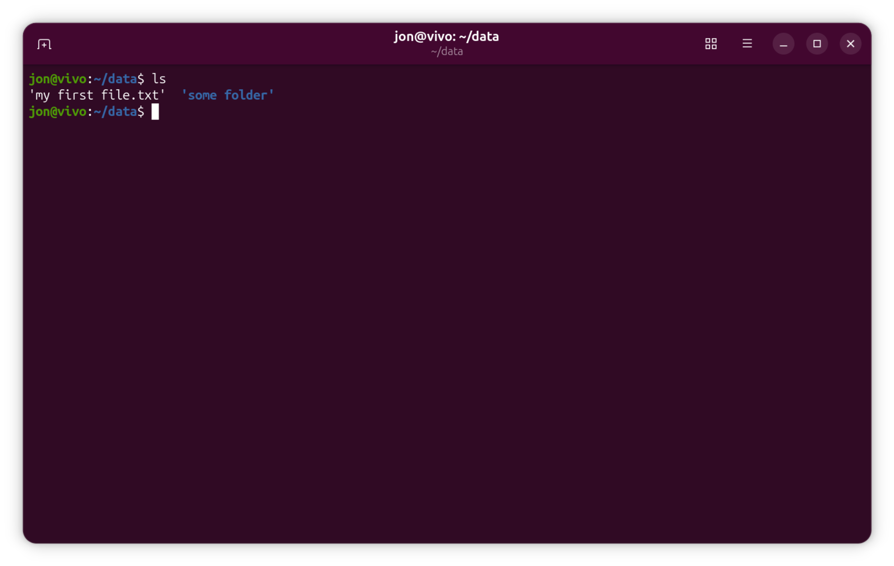
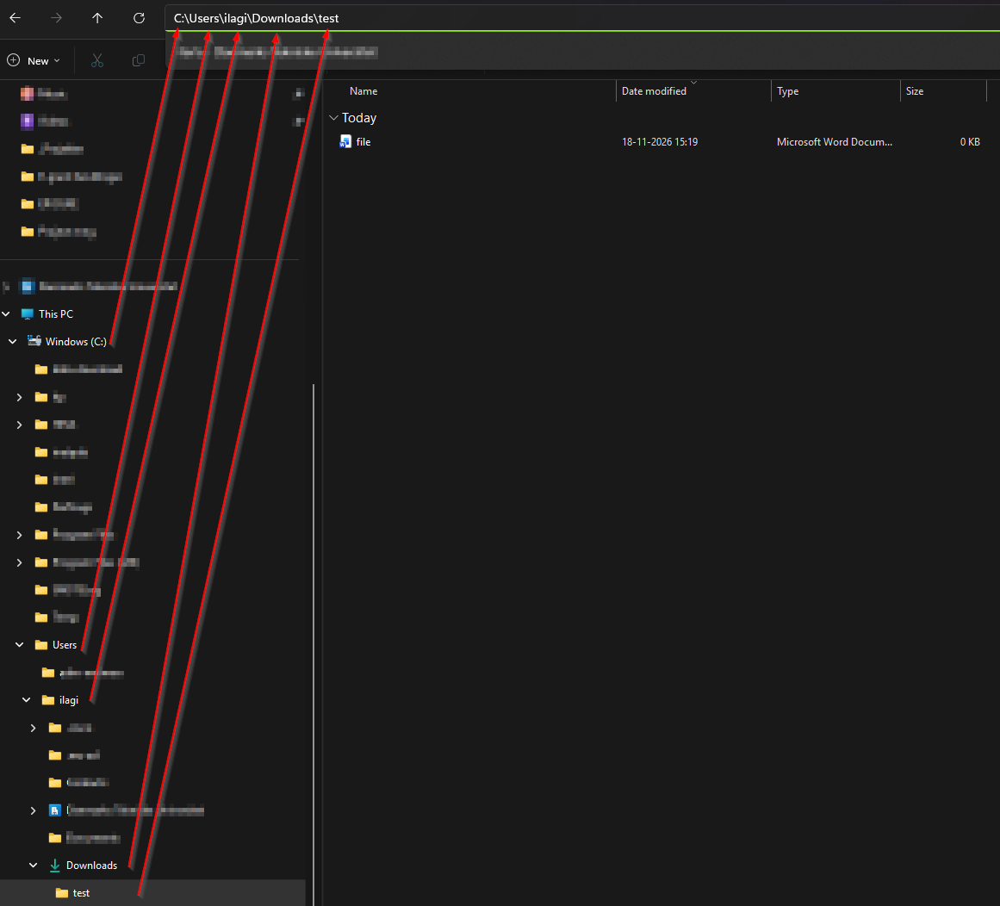

# First command

With the commandline open, one can give commands to the computer. Let's try that now. Type the following command and press enter:

    
COMMAND
 dir

Did you see what "dir" did? It listed the content of the directory. So what is happening?
When one is in the commandline (also called terminal) its always in the context of a "current folder". This is what is before the prompt, here its <strong>C:\data</strong>. "dir" is then a program ran in the context of the current folder, this is how it knows which folder to display.

    
COMMAND
 ls

Did you see what "ls" did? It listed the content of the directory. So what is happening?
When one is in the commandline (also called terminal) its always in the context of a "current folder". This is what is before the prompt, here its <strong>~/data</strong>. "ls" is then a program ran in the context of the current folder, this is how it knows which folder to display.

    <strong>TIP:</strong> Instead of typing commands from scratch everytime, one can use arrow key ↑ or ↓ to go through the command history. This can save a lot of typing. When more commands have been written pressing ↑ multiple times, will iterate over them.

Seeing <strong>C:\data</strong> might be strange, but all the files and folder you work with normally has the same structure. In the commandline we just use backslashes ("\\") instead of folders one clicks through. It's the exact same hierarchy:

