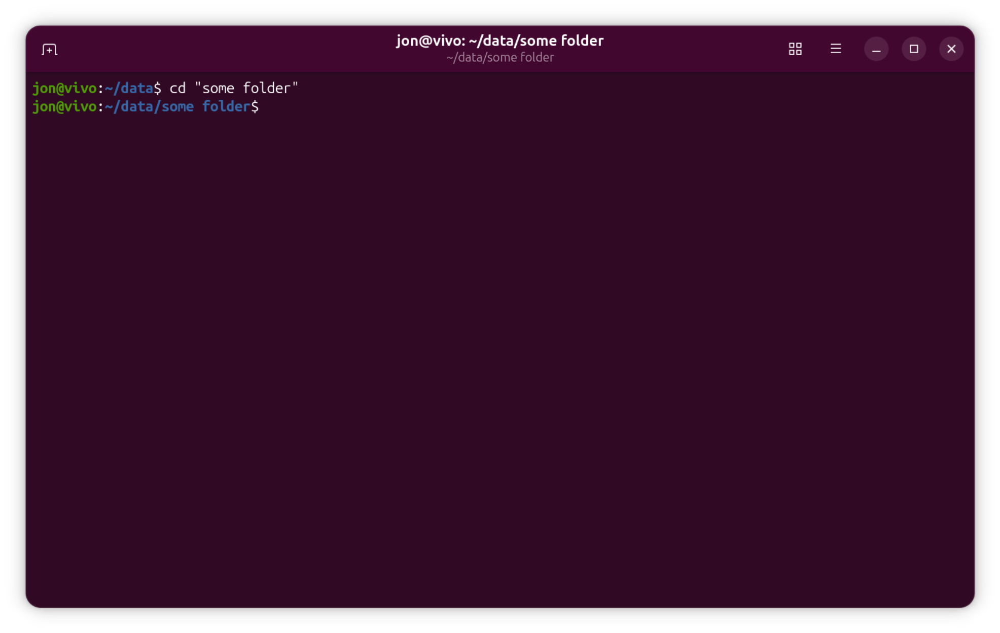
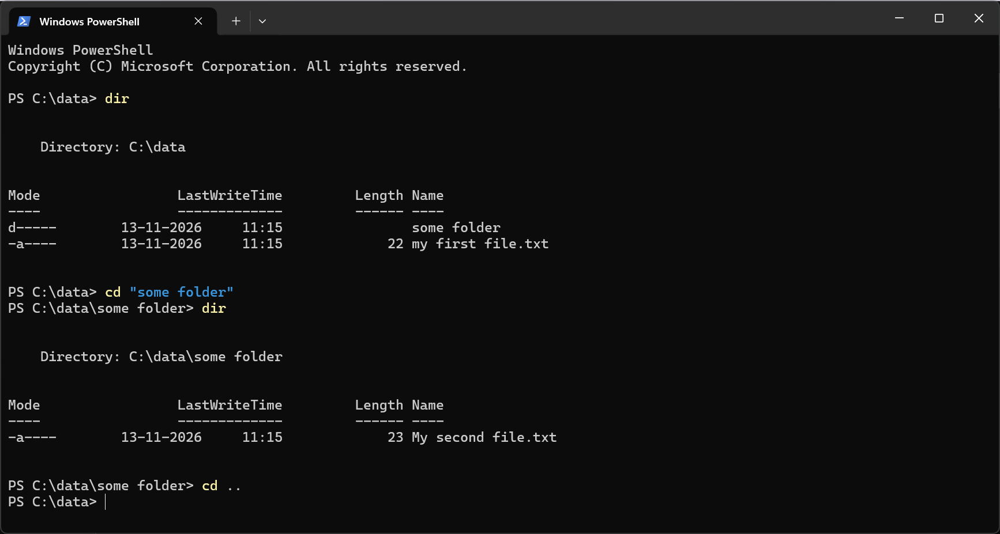
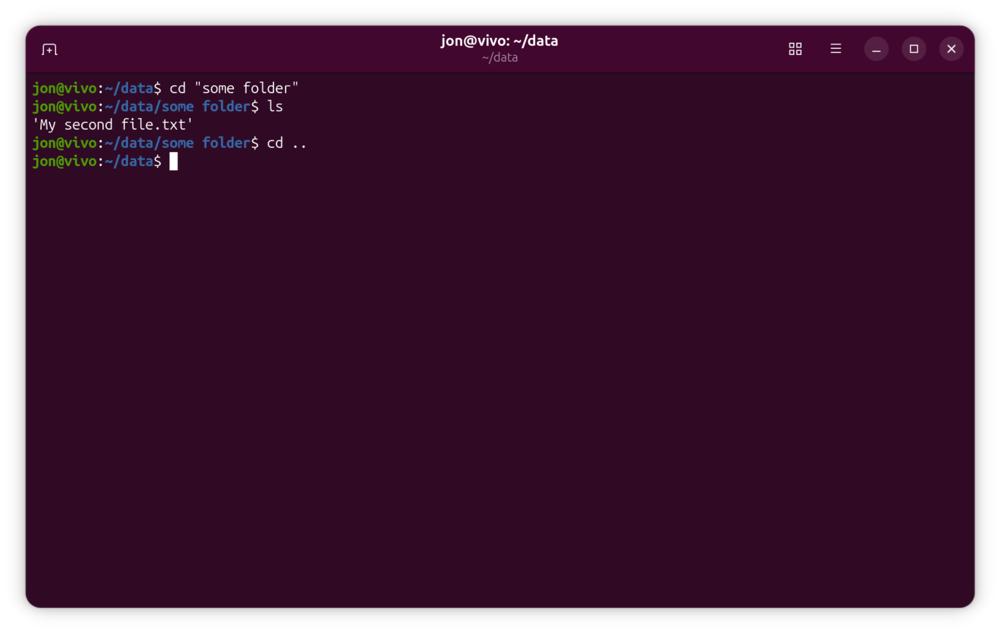
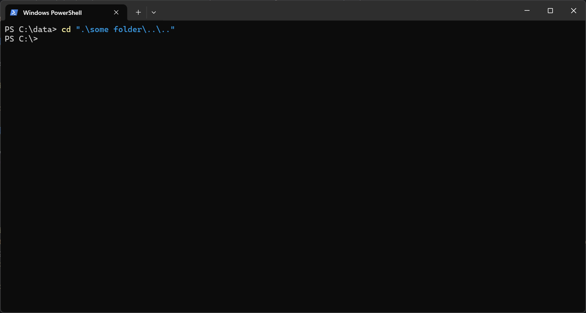
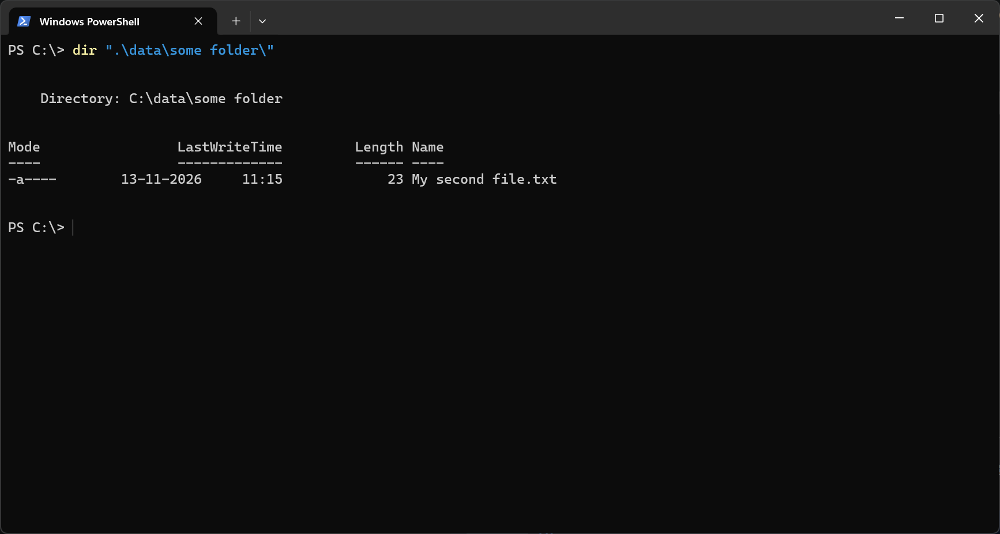
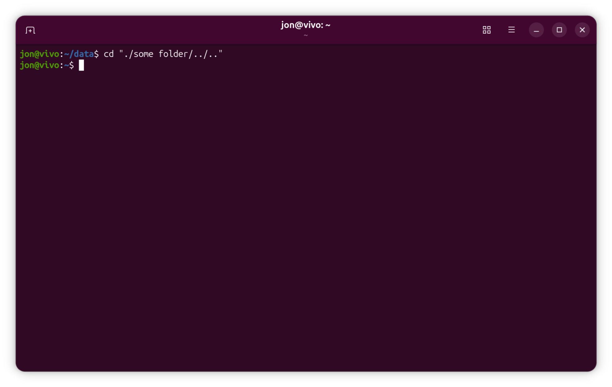
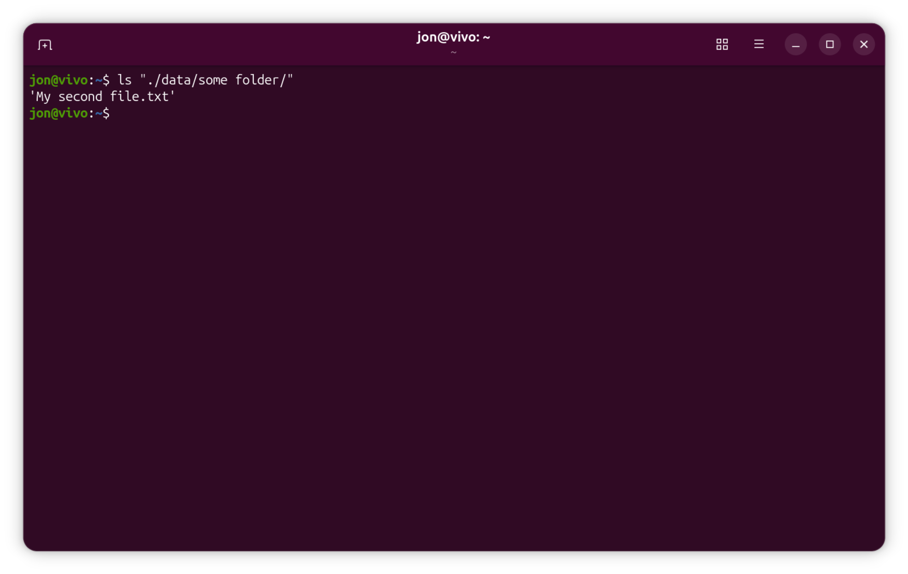

# Navigation

Let say that we want to change which directory we are in. This can be done with the "cd" command:

The prompt is now "C:\data\some folder".

The prompt is now "~/data/some folder". "~" means your home folder.

We have now entered "some folder". A very important detail is that because "some folder" contains " ", then we need to encapsulate it in quotes.
Imagine the folder was called "some-folder" instead, then one could do:

    
COMMAND
 cd some-folder

Instead of:

    
COMMAND
 cd "some folder"

which is why many people prefer to use names without space when working in the command prompt. Parameters to programs are separated by space, so without quotes the cd would interpret the command as cd "some" "folder", instead of a single parameter.

Let's investigate the current folder:

    
COMMAND
 ls

Great! We have now opened the folder, displayed its contents, but how do we leave again? By doing this:

    
COMMAND
 cd ..

Now we are back. ".." is special and mean parent folder.
"." is also special, and mean current folder. Using this knowledge, it's possible to combine multiple of the above commands:

Let's break it down:
"." is the current directory, so from "C:\data>" as it's there the command is executed from.
From the current folder, we enter "some folder". This is ".\some folder\".
From "some folder", we go to the parent directory twice, i.e. we go back into "data" and from there to the "C:" drive directly.

Using relative paths also work with "dir". From "C:\" lets display the contents of the inner folder:

Let's break it down:
"." is the current directory, so "~/data" as it's there the command is executed from.
From the current folder, we enter "some folder". This is "./some folder/".
From "some folder", we go to the parent directory twice, i.e. we go back into "data" and from there to the home folder.

Using relative paths also work with "ls". From "~" lets display the contents of the inner folder:

This drives home one of the main points for running commands. The "<Strong>working directory</Strong>" of a program is important. Changing where it executes changes the outcome of the command.

Open PowerShell and play around with "cd" and "dir" on your own machine.

Open the terminal and play around with "cd" and "ls" on your own machine.

<Strong>TIP: </Strong>the tab button can be used to autocomplete in the terminal. If one types the beginning of a folder like "som" and presses tab, then it will attempt to autocomplete to "some folder". If there are multiple options, pressing tab again can show them or iterate over them, depending on the terminal.

What we have used to far are called "relative paths" because the result depends on the start location of the command. It also possible to use absolute paths by specifying it from the root:

    
COMMAND
 dir "C:\data\"

    
COMMAND
 ls "/home/jon/data/"

Here "/home/jon" is the home folder shown in the examples. Replace "jon" with your own username to use your home folder.

This can be executed from any folder, and will always give the same result.

The examples on the following pages will use ~/data, which for a given user also always give the same result.

