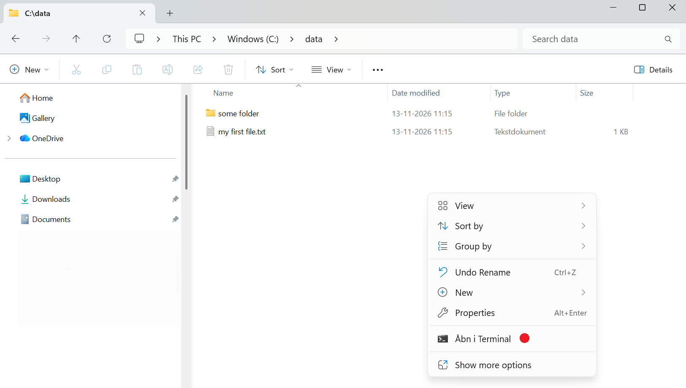
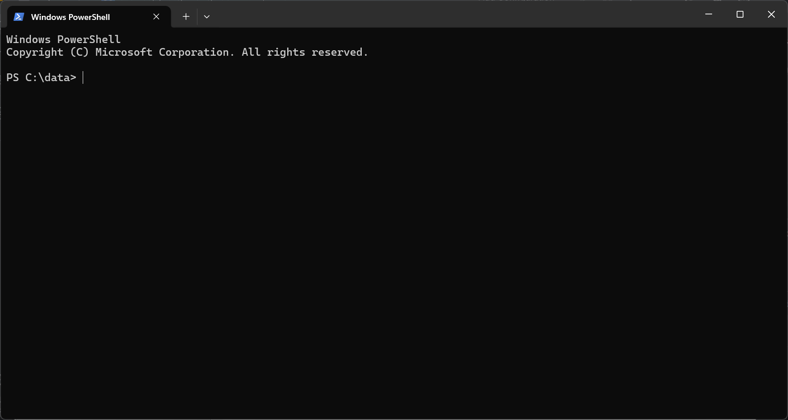

Now, lets get started with the command line. It's a way of giving commands 

Navigate to a folder where you have some files you are interested in transferring. Right click and click "Open in terminial":

It should end up looking like this:

    <Strong>Note: </Strong> check that your prompt start with PS. If it does not, then write "powershell" and press enter.

Now you are in the commandline - specifically PowerShell. Great!

It might not look exactly the same, as there are different styles depending on which flavor of linux is installed on your machine.

The guide will use "C:\data", but it can be an arbitrary folder - its simply some data we are interested in moving to the object storage.