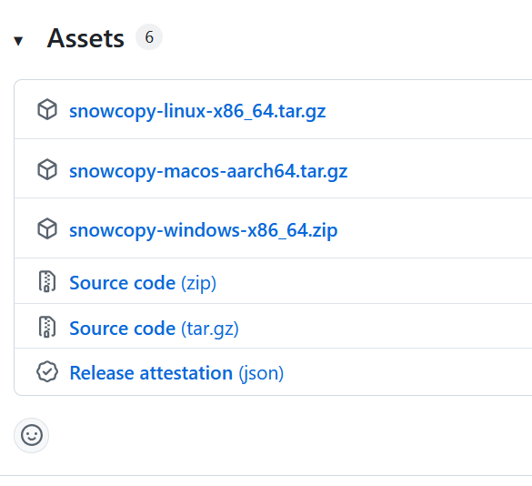
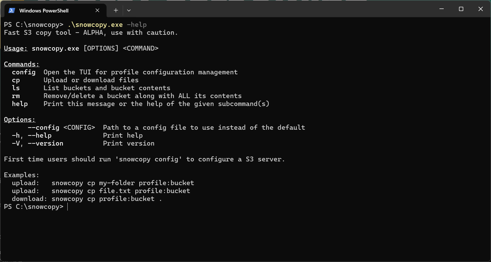
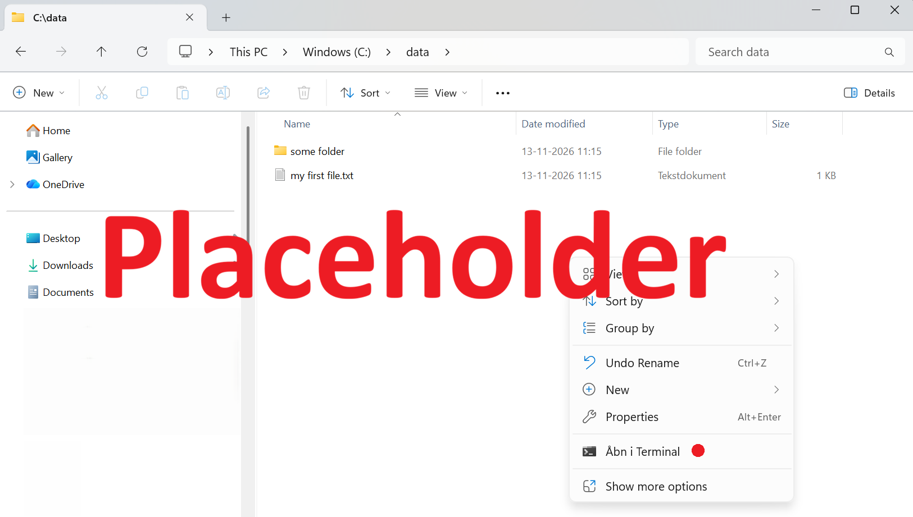

# Installation
Now we will use snowcopy to transfer files to and from a S3 server.

First, we need to download it. The newest version can found on the release pages in github: [https://github.com/DeiC-HPC/Snowcopy/releases](https://github.com/DeiC-HPC/Snowcopy/releases)

Under assets, select the one with windows in its name.

Download it and unpack the zip folder. In there you can find "snowcopy.exe".

    <Strong>INFO: </Strong> snowcopy is slow to start on many Windows machines as its new software and thus is scanned on startup. We are working on a solution.
If one is comfortable, this can be solved by placing snowcopy in folder where windows defender is excluded. Consult your local IT department first if this is unknown territory to you. 

Under assets, select the one for linux.

Download it and unpack the zip folder. In there you can find "snowcopy".

Move snowcopy to any directory you prefer. From there open a terminal and run the following command:

    

        
COMMAND
 .\snowcopy.exe help"
    

    

        
COMMAND
 snowcopy help"
    

