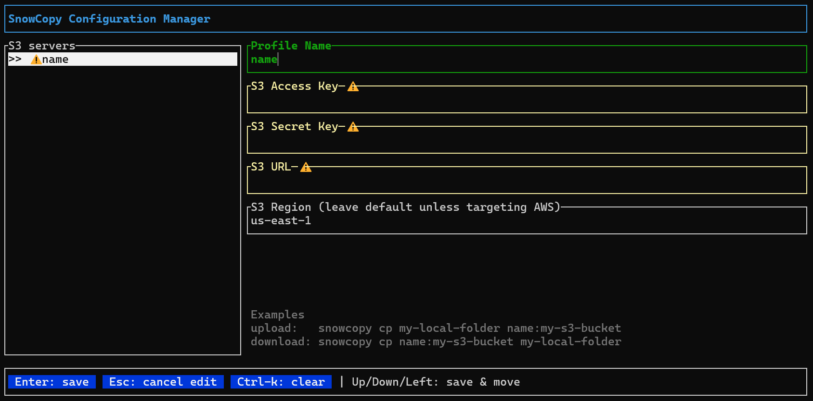
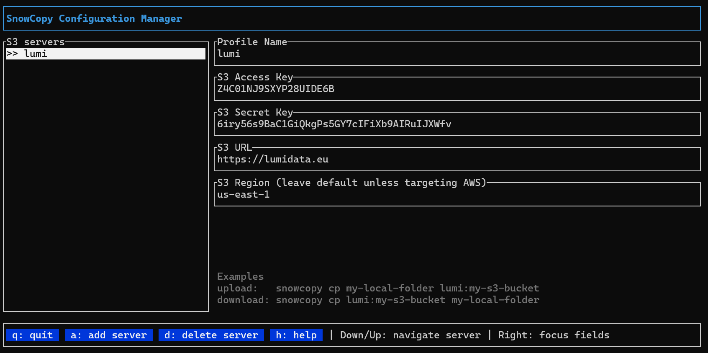

# Configuration

To use snowcopy, one has to configure it first. Run:

    
COMMAND
 .\snowcopy.exe config

    
COMMAND
 ./snowcopy config

This will open the configuration manager:

Let's configure it. For this example we will use the object storage at the LUMI super computer.
To navigate, use the arrow keys or simply click with your mouse on the field you want to edit. When you leave a field, its value is automatically saved.

* <Strong>Profile name:</Strong> choose something short and sweet, since this is what you will reference this specific s3 server with when transferring files. The name will be part of the commands on the following pages. The examples use "<Strong>lumi</Strong>".
* <Strong>S3 Access key:</Strong> provided by the S3 service. This is part of your login and should thus be treated with the same secrecy as a password. 
* <Strong>S3 Secret key:</Strong> provided by the S3 service. This is part of your login and should thus be treated with the same secrecy as a password.
* <Strong>S3 url:</Strong> provided by the S3 service. 
* <Strong>S3 region:</Strong> its unlikely there is any need to change this unless specified directly by the S3 service.

Fill in the values and quit the config manager. If you are unsure where to get the credentials, search the documentation of the S3 service or contact their support.

    <Strong>Tip: </Strong> tip its possible to paste with ctrl+v in the config editor.

    <Strong>Note: </Strong> this configuration is tied to your user on your local machine.

