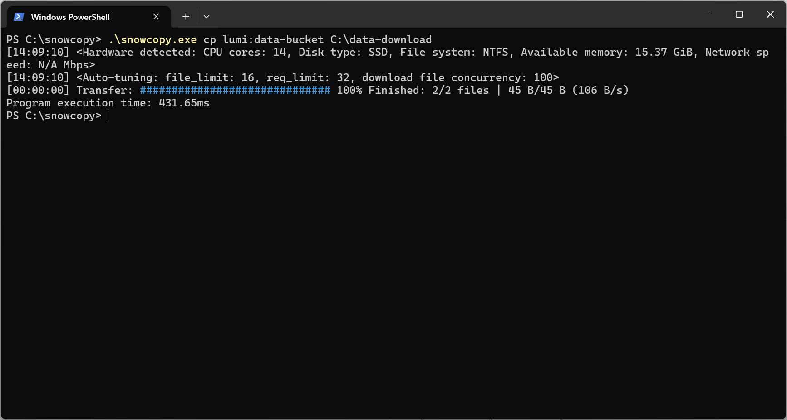
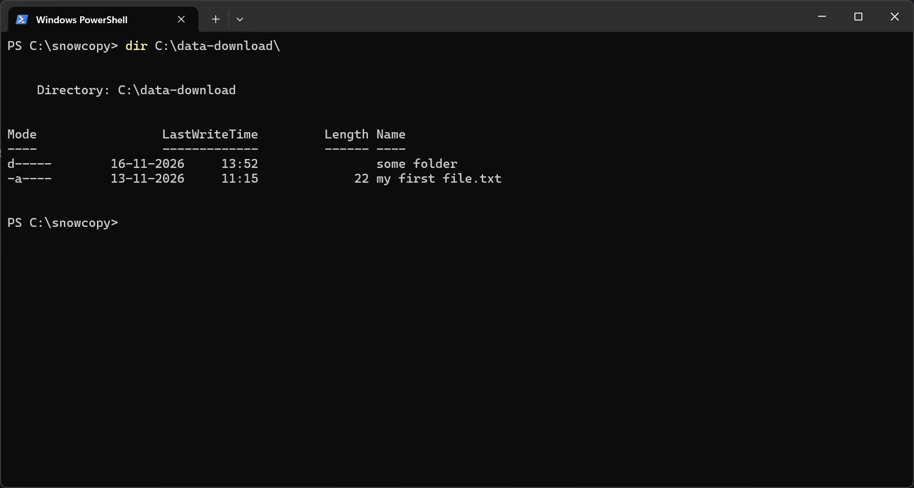
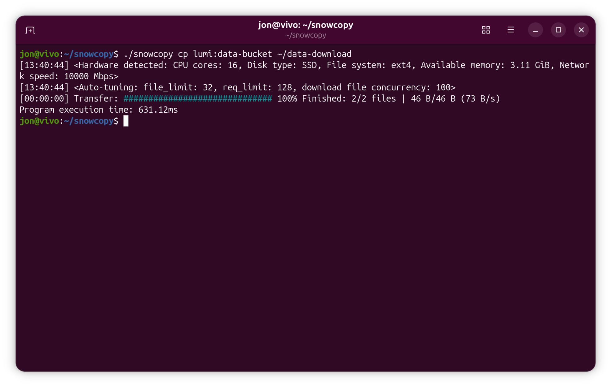
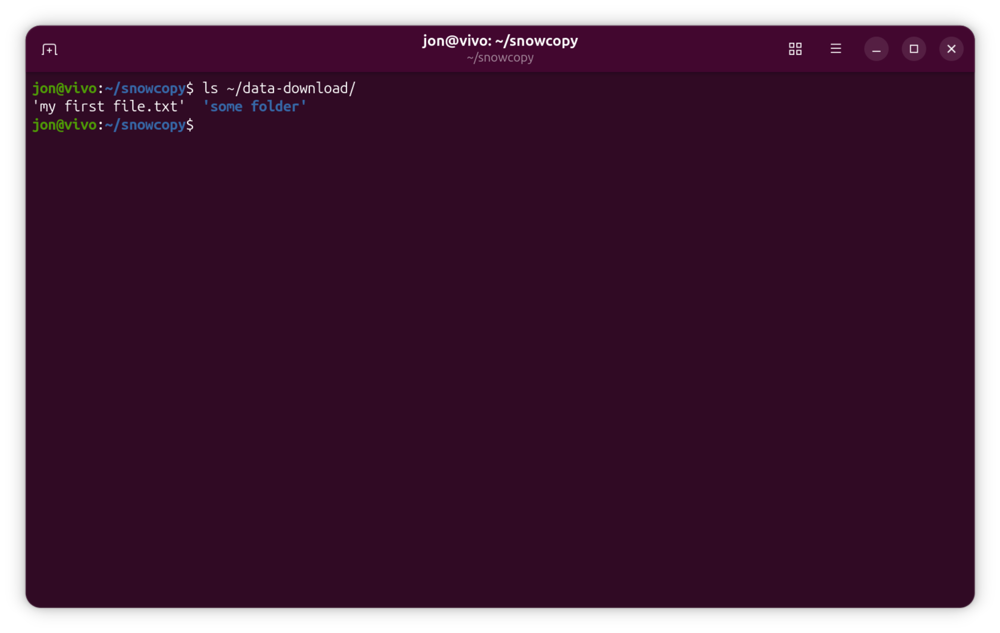

# Download files

Let's download the files again. To do that we reverse the command such that the s3 server is on left part of the command. It should be read as [cp from -> to].

    
COMMAND
 .\snowcopy.exe cp lumi:data-bucket C:\data-download

C:\data-download is created if it does not exist. If we now run the dir command on our newest downloaded folder, we can see that the contents matches what we uploaded:

    
COMMAND
 ./snowcopy cp lumi:data-bucket ~/data-download

~/data-download is created if it does not exist. If we now run the ls command on our newest downloaded folder, we can see that the contents matches what we uploaded:

Congratulations, if you have followed so far, then we have configured snowcopy, uploaded data and downloaded it again.
This is just the basic functionality and more information about how to use the tool can be found in our readme: [https://github.com/DeiC-HPC/Snowcopy](https://github.com/DeiC-HPC/Snowcopy)