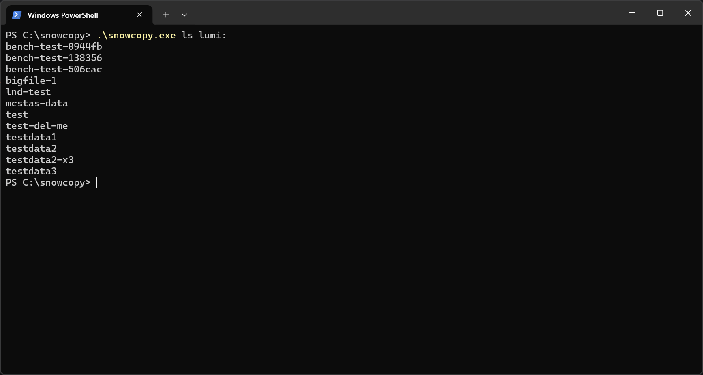
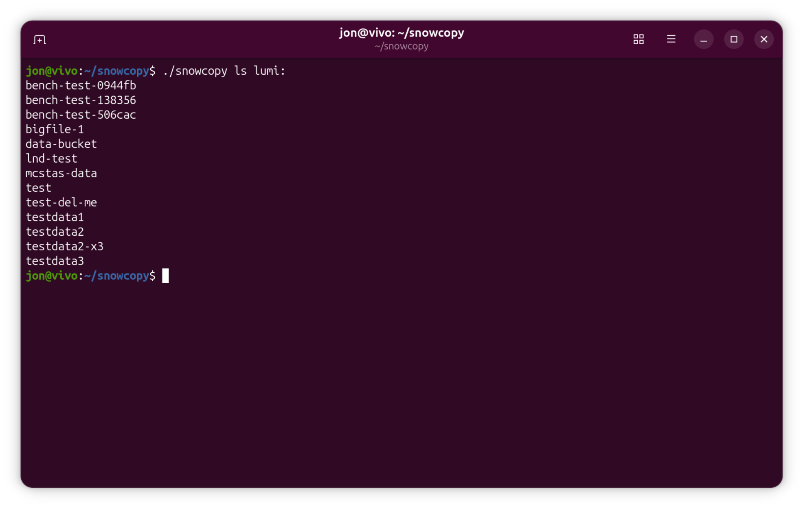

# Exploring server contents

With snowcopy configured, lets see if there are buckets on the remote server by using snowcopy's ls command:

    
COMMAND
 .\snowcopy.exe ls lumi:

    
COMMAND
 ./snowcopy ls lumi:

This lists the buckets on the server. If it's fresh, then the list would be empty.