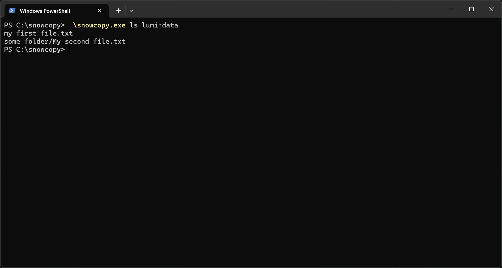
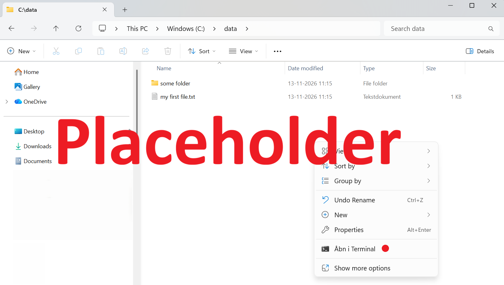

# List files

Let's explore our new bucket to confirm that its contents is as we expect.

    
COMMAND
 .\snowcopy.exe ls lumi:data-bucket

    
COMMAND
 ./snowcopy ls lumi:data-bucket

This displays the contents of data-bucket.

Recall that each file is mapped to an object:

{{#include ../../snippets/path-mapping.html}}

We have two files in C:\data\ and they are listed in the bucket. Since we transferred the contents of data, there is no mention of the data folder.