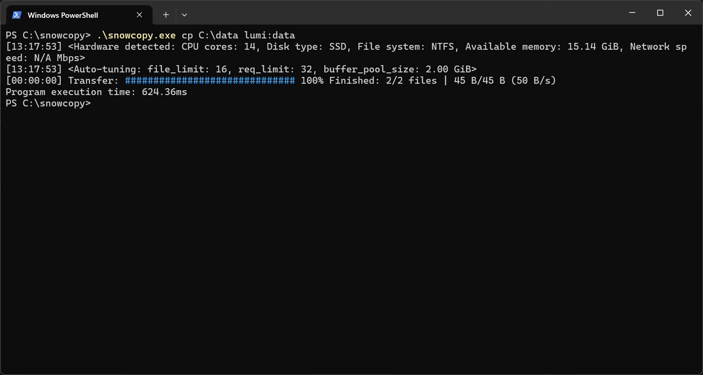

# Upload files

Let's upload the data folder that we were working with earlier. 

    
COMMAND
 .\snowcopy.exe cp C:\data lumi:data-bucket

    
COMMAND
 ./snowcopy cp /data lumi:data-bucket

This uploads the contents of data into the new data-bucket.

    <Strong>Note: </Strong> snowcopy automatically creates the bucket if it does not exist prior to the copy.

